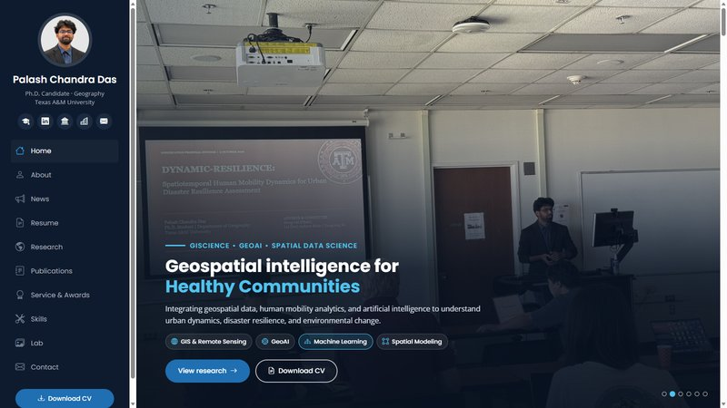
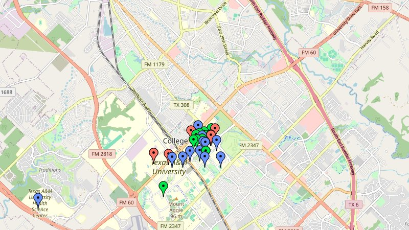
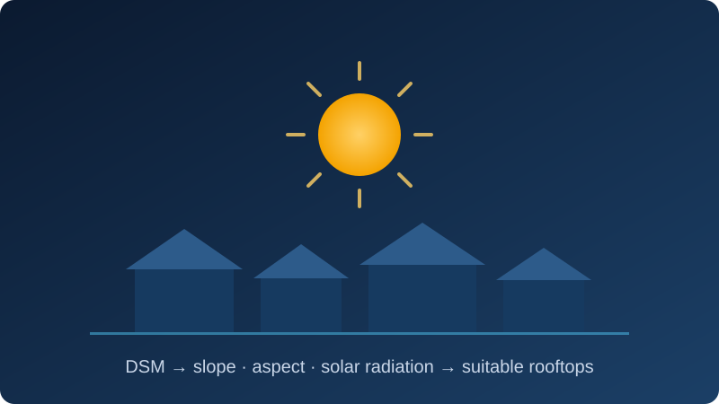

  

  
  
  
  
  

 

### 👋 About

Geospatial data scientist and urban planner, now a **Ph.D. Candidate in Geography at Texas A&M University** in the
[City Analytics & Informatics Lab](https://www.cityanalytics.info). Research brings together **large-scale human mobility data,
remote sensing, and machine learning** to understand how cities respond to and recover from disasters, and how people,
places, and environments change over time.

🎓 **Dissertation:** *Dynamic-Resilience: Spatiotemporal Human Mobility Dynamics for Urban Disaster Resilience Assessment*

### 🔬 Research areas

<table>
<tr>
<td width="50%" valign="top">

**🌪️ Disasters & human mobility** 
Post-disaster business and healthcare visitation recovery measured with mobile phone location data.

</td>
<td width="50%" valign="top">

**🌡️ Urban heat & population dynamics** 
Hourly population estimates and dynamic heat exposure with dasymetric mapping.

</td>
</tr>
<tr>
<td width="50%" valign="top">

**🛰️ Environment & remote sensing** 
Groundwater potential, soil salinity, land-use change, and urban runoff with machine learning.

</td>
<td width="50%" valign="top">

**🚲 Transportation** 
Bikeshare safety, traffic congestion, and public transport performance.

</td>
</tr>
</table>

### 🏆 Highlights

| | |
|:--:|:--|
| 🥇 | **First Place**, Graduate Student Poster Competition, TxGIS Day 2026 |
| 🎤 | **Dissertation proposal defended**, Texas A&M, Oct 2026 |
| 📄 | **New first-author paper** in *Annals of GIS* (2026) on post-disaster business recovery |
| 🏅 | **Jeanne X. Kasperson Student Paper Award**, AAG Annual Meeting 2025 |

### 📚 Selected publications

- **Das, P. C.**, Cai, H., Tian, H., Sumiya, N. N., Mandal, D., & Deng, C. (2026). Rapid assessment of post-disaster business visitation recovery and its evolving drivers using mobile phone location data. ***Annals of GIS***. 
- Lin, B., Cai, H., Tian, H., Fu, D., **Das, P. C.**, Sumiya, N. N., & Yin, Z. (2026). Quantifying healthcare visitation disruptions using mobile phone location data during disasters: A case study of Hurricane Beryl. ***Progress in Disaster Science***, 31, 100623. 
- Sarkar, S. K., Rudra, R. R., Talukdar, S., **Das, P. C.**, et al. (2024). Future groundwater potential mapping using machine learning algorithms and climate change scenarios in Bangladesh. ***Scientific Reports***, 14, 10328. 
- **Das, P. C.**, & Esraz-Ul-Zannat, M. (2022). Assessing the impacts of land use–land cover changes on direct surface runoff: A remote sensing approach in Khulna City. ***Water Science and Technology***, 85(10), 3122–3144. 

<b>More journal articles (7)</b>

 

- Sarkar, S. K., Saroar, M. M., **Das, P. C.**, et al. (2023). Artificial neural network-based land use-specific carbon patterns and their effects on land surface temperature as a result of the Rohingya refugee influx. *IEEE Access*, 11, 142964–142978. [DOI](https://doi.org/10.1109/ACCESS.2023.3340983)
- Sarkar, S. K., Rudra, R. R., Sohan, A. R., **Das, P. C.**, et al. (2023). Coupling of machine learning and remote sensing for soil salinity mapping in coastal area of Bangladesh. *Scientific Reports*, 13, 17056. [DOI](https://doi.org/10.1038/s41598-023-44132-4)
- Sarkar, S. K., Rudra, R. R., Nur, M. S., & **Das, P. C.** (2023). Partial least-squares regression for soil salinity mapping in Bangladesh. *Ecological Indicators*, 154, 110825. [DOI](https://doi.org/10.1016/j.ecolind.2023.110825)
- Sarkar, S. K., Shabab, K. R., **Das, P. C.**, & Zaki, M. H. (2023). Investigating the spatial collision factors associated with bikeshare crashes at Washington, D.C. *Spatial Information Research*, 31(1), 91–99. [DOI](https://doi.org/10.1007/s41324-022-00477-y)
- Sarkar, S. K., Esraz-Ul-Zannat, M., **Das, P. C.**, & Ekram, K. M. E. (2022). Delineating the groundwater potential zones in Bangladesh. *Water Supply*, 22(4), 4500–4516. [DOI](https://doi.org/10.2166/ws.2022.113)
- Sarkar, S. K., Ekram, K. M. M., & **Das, P. C.** (2021). Spatial modeling of COVID-19 transmission in Bangladesh. *Spatial Information Research*, 29(5), 715–726. [DOI](https://doi.org/10.1007/s41324-021-00387-5)
- **Das, P. C.**, Bintee, N. Z., Azad, A. K., & Roy, T. K. (2019). Traffic congestion induced cost of a road section: A study on Fulbarigate to Dakbangla midblock, Khulna. *Journal of Engineering Science*, 10(1), 103–112.

Conference talks and papers are on the [website](https://pcdas1993.github.io/#publications).

### 🗺️ Featured projects

<table>
<tr>
<td width="33%" valign="top" align="center">
 
<b><a href="https://github.com/pcdas1993/pcdas1993.github.io">Personal website</a></b> 
Academic site with research, publications, and CV. HTML · CSS · JavaScript · <a href="https://pcdas1993.github.io">Live ↗</a>
</td>
<td width="33%" valign="top" align="center">
 
<b><a href="https://github.com/pcdas1993/WebGIS_geog478_Project">Campus Pocket Pantries WebGIS</a></b> 
Interactive map of food access across Texas A&M. Leaflet · JavaScript · <a href="https://pcdas1993.github.io/WebGIS_geog478_Project/">Live ↗</a>
</td>
<td width="33%" valign="top" align="center">
 
<b><a href="https://github.com/pcdas1993/GEOG392_Project">Solar suitability automation</a></b> 
Rooftop solar suitability from a DSM, automated. Python · ArcPy
</td>
</tr>
</table>

### 🧰 Tools

 

**Data:** mobile phone location data · Census/ACS · LandScan USA · Landsat · NLCD · Daymet · gridMET

